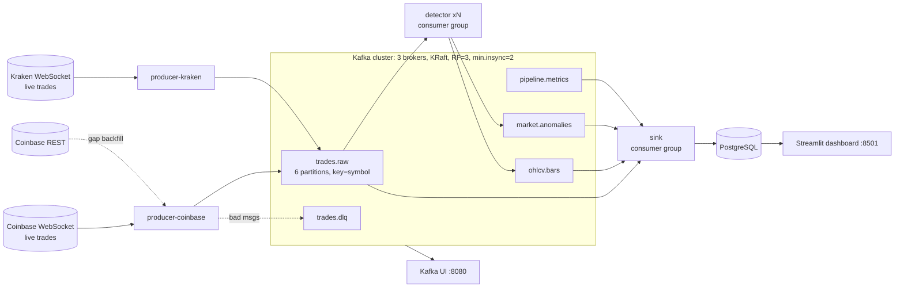

# Real-time Crypto Market Surveillance with Kafka

**Domain:** Finance (crypto spot markets) **Business objective:** real-time **anomaly detection** for
a trading-desk or compliance team: spot whale trades, sudden price spikes, volume bursts and
cross-exchange price divergence within seconds of them happening.

**Data source:** *live, real* trade streams from two public exchange WebSocket APIs (both are on the
[conduktor/public-streaming-api](https://github.com/conduktor/public-streaming-api) list). No API key needed.
**No synthetic data is generated anywhere in the pipeline.**

| Source | Endpoint | Channel | Docs |
|---|---|---|---|
| Coinbase Exchange | `wss://ws-feed.exchange.coinbase.com` | `matches` + `heartbeat` | https://docs.cdp.coinbase.com/exchange/websocket-feed/channels |
| Kraken Spot v2 | `wss://ws.kraken.com/v2` | `trade` | https://docs.kraken.com/api/docs/websocket-v2/trade |
| Coinbase REST (gap repair only) | `https://api.exchange.coinbase.com/products/{id}/trades` | – | https://docs.cdp.coinbase.com/exchange/reference |

Markets tracked by default: `BTC-USD, ETH-USD, SOL-USD, XRP-USD, DOGE-USD, ADA-USD` on both exchanges.

---

## 1. Architecture



| Component | What it does |
|---|---|
| `producer-coinbase`, `producer-kraken` (`app/producer.py`, `app/exchanges/`) | Connect to the live WebSocket, normalize each trade into one JSON schema, publish to `trades.raw` keyed by symbol. Reconnect with exponential backoff, a silence watchdog, sequence-gap detection on exchange trade ids, REST backfill of missed Coinbase trades, and malformed messages routed to `trades.dlq`. |
| `detector` (`app/detector.py`, `app/analytics/`) | Consumer group `anomaly-detector`. Builds event-time 10-second OHLCV bars with watermark and allowed lateness, runs 4 detectors, and publishes to `ohlcv.bars` and `market.anomalies`. Horizontally scalable. |
| `sink` (`app/sink.py`) | Consumer group `postgres-sink`. Batches records into PostgreSQL with idempotent upserts, then commits offsets. |
| `dashboard` (`app/dashboard.py`) | Live prices per exchange, anomaly feed, throughput, latency percentiles, and data-quality metrics. |
| `kafka-ui` | Inspect topics, partitions, messages and consumer lag during the demo. |

### Anomaly detectors (`app/analytics/detectors.py`)
| Type | Rule (all thresholds configurable in `.env`) |
|---|---|
| `WHALE_TRADE` | Trade notional ≥ $50k **and** z-score of log(notional) ≥ 3.5 vs. the last 2,000 trades of that market |
| `PRICE_SPIKE` | 10s bar log-return with z-score ≥ 4 vs. the last 180 bars **and** a move of at least 10 bps |
| `VOLUME_BURST` | 10s bar notional with z-score of log(notional) ≥ 4 **and** ≥ 5× the rolling median |
| `CROSS_EXCHANGE_DIVERGENCE` | Coinbase vs. Kraken price for the same asset differs by ≥ 25 bps within 5 s (30 s cooldown) |

Because the producers key messages by **symbol**, all trades for one asset from both exchanges land in
the same partition. Each symbol's state therefore lives in exactly one detector instance, which is
what makes stateful processing and cross-exchange comparison work when the detector scales out.

### Business objectives on the dashboard (page "Business objectives")
| # | Objective | Who uses it | What the dashboard shows |
|---|---|---|---|
| 1 | **Large-trade & market-abuse surveillance** | Compliance team | Whale alerts, total flagged volume, largest trade, share of volume in big trades, volume bursts, list of the latest flagged trades |
| 2 | **Cross-exchange arbitrage monitoring** | Trading desk | Live Coinbase vs Kraken price per coin, spread in bps, where it is cheaper, a status traffic light, spread-over-time chart, divergence alerts |
| 3 | **Market risk: volatility, order-flow pressure & liquidity** | Risk team | Volatility per coin, buy-pressure % (buyers vs sellers), traded USD, number of trades and price-spike alerts per coin, plus a volatility ranking |

The other pages are **Market** (prices, volume, anomaly feed) and **Pipeline & servers** (live Kafka broker
and replica status, service heartbeats, throughput, latency, data quality, buffer depth).

---

## 2. How the five pipeline measures are addressed

| Measure | Design decisions | How to show it |
|---|---|---|
| **Throughput** | Producer batching (`linger.ms=5`, 256 KB batches), lz4 compression, batch consume of 1,000–2,000 records, `executemany` DB writes, 6 partitions | Dashboard throughput panel; `report` tool; `throughput_test` benchmark (section 5) |
| **Latency** | Small linger, `fetch.wait.max.ms=50`, async produce, commit per batch. Every trade carries `event_ts` (exchange), `ingest_ts` (producer) and `sink_ts` (DB) | Dashboard p50/p95/p99; `report` tool. *Pipeline latency* (producer→Kafka→DB) uses one clock, so it is exact. *Exchange→DB* also includes internet delay and exchange clock skew. |
| **Scalability** | Partitioned topics + consumer groups; stateless sink; detector state partitioned by key | `docker compose up -d --scale detector=3`, then watch partitions rebalance in Kafka UI and on the dashboard |
| **Reliability** | 3 brokers, RF=3, `min.insync.replicas=2`, `acks=all`, idempotent producer, manual offset commits only after outputs are durable, restart policies, WebSocket auto-reconnect + watchdog, DLQ | Stop a broker, kill a detector, or restart a producer (section 4) |
| **Accuracy** | Schema validation; sequence-gap detection on exchange trade ids; REST backfill for Coinbase gaps; event-time windows with watermark and late-trade accounting; deterministic anomaly ids + DB primary keys mean replays create no duplicates (effectively-once) | `report` tool: completeness % per market from trade-id continuity, and duplicate rows (= 0) |

---

## 3. Run / reproduce

### Prerequisites
* **Docker Desktop** (Windows/macOS) or Docker Engine + Compose v2.24+ (Linux)
* ~6 GB RAM free for Docker (Docker Desktop → Settings → Resources)
* Internet access to `ws-feed.exchange.coinbase.com`, `ws.kraken.com`, `api.exchange.coinbase.com`
* Free ports: 8080, 8501, 5433, 29092, 39092, 49092

### Start
```bash
git clone <your-repo-url> crypto-market-surveillance
cd crypto-market-surveillance
docker compose up -d --build
```
The first start takes 2–4 minutes: it pulls images, builds the app image, waits for the 3 Kafka
brokers to become healthy, and creates the topics.

### Verify it works
```bash
docker compose ps                              # all services "running"; kafka-init "exited (0)"
docker compose logs -f producer-coinbase       # "connected and subscribed", then [metrics] lines every 10 s
docker compose logs -f detector                # "ANOMALY ..." lines appear as they happen
```
* Dashboard: **http://localhost:8501** (bars appear after ~15 s; bar-based detectors need ~3 min warm-up)
* Kafka UI: **http://localhost:8080** (topics → `trades.raw` → Messages shows the live trades)

### Results for the presentation
```bash
docker compose exec sink python -m app.tools.report
```
This prints throughput, latency percentiles, completeness per market, the duplicate count and anomaly counts.

### Run the unit tests
```bash
docker compose run --rm detector pytest -q
```

### Stop / clean up
```bash
docker compose down        # stop (Postgres data is kept in a volume)
docker compose down -v     # stop and delete all data
```

---

## 4. Demo scenarios (reliability & scalability)

| Scenario | Command | What you should see |
|---|---|---|
| Scale out the stream processor | `docker compose up -d --scale detector=3` | Kafka UI → Consumers → `anomaly-detector`: 6 partitions spread across 3 members; the dashboard "Detector instances" table shows 3 instances |
| Broker failure | `docker compose stop kafka2` → wait → `docker compose start kafka2` | Pipeline keeps running (RF=3, min ISR=2); no delivery failures; partitions move back to the ISR after restart |
| Processor crash | `docker compose kill detector` → `docker compose up -d detector` | Resumes from the last committed offset; no lost or duplicated anomalies (`report` duplicate count = 0) |
| Source disconnect / producer crash | `docker compose stop producer-coinbase` → wait 30 s → `docker compose start producer-coinbase` | On start the producer reads the tail of `trades.raw` to recover the last trade id it published per symbol (log line `recovered last published trade ids`). The first live trade reveals the downtime gap, and Coinbase trades are **backfilled from REST** (`backfilled` counter on the dashboard; completeness in `report` stays ~100 %) |
| Sink / DB outage | `docker compose stop postgres` → `docker compose start postgres` | Kafka buffers the data; the sink restarts and catches up; consumer lag in Kafka UI goes up, then back to 0 |

### What happens if a server goes off?
| Server that fails | What happens | Data lost? |
|---|---|---|
| **1 Kafka broker** | The KRaft controllers elect new partition leaders from the remaining in-sync replicas within seconds. Producers and consumers reconnect automatically. The dashboard shows "Brokers online 2/3" and under-replicated partitions | **No** (RF=3, `acks=all`, `min.insync.replicas=2`) |
| **2 Kafka brokers** | Writes are rejected (not enough in-sync replicas). Producers retry for up to 120 s and buffer trades in memory. Consistency is chosen over unsafe writes | No, if a broker returns within the retry window |
| **Producer** | Docker restarts it. On start it recovers the last published trade ids from Kafka, detects the gap and backfills Coinbase trades from REST | **No** for Coinbase. Kraken gaps are counted |
| **Detector** | The uncommitted batch is re-read after restart, and deterministic anomaly ids avoid duplicates. With several instances, Kafka moves its partitions to the others (rebalance) | **No** |
| **Sink / PostgreSQL** | Data waits in Kafka (7-day retention) and consumer lag grows. The sink resumes from its last committed offset and catches up | **No** |
| **Exchange / internet** | Watchdog + reconnect with exponential backoff. Missed Coinbase trades are backfilled after reconnect | **No** for Coinbase |
| **Dashboard** | Only the display stops. The pipeline is not affected | No |

### What if the producer gets a lot of data at once (burst)?
1. **Exchanges batch trades**: one Kraken message can carry many trades, and the parser handles the whole array.
2. **In-memory buffer**: WebSocket reading and Kafka sending are separated by an asyncio queue (200,000 trades), so a burst never blocks the connection. Its depth is shown as `buffer_queue_depth`.
3. **Kafka client batching**: librdkafka groups messages into compressed batches (`linger.ms=5`, 256 KB, lz4), which makes bursts more efficient, not slower. Its local queue holds 500,000 messages.
4. **Back-pressure**: if that queue is full, `produce()` raises `BufferError`. The producer waits for acknowledgements and retries, so nothing is dropped.
5. **Downstream**: Kafka stores the burst durably, and consumers read up to 1,000–2,000 records per batch. If they fall behind, lag grows temporarily; scale with `--scale detector=N` (up to 6 = partitions).
6. **Evidence**: the REST backfill after a restart pushes hundreds of trades at once (observed: 639 trades, 70 msg/s burst, 0 failures), and `throughput_test` replays real trades as fast as possible.

---

## 5. Throughput benchmark (real data)

After the pipeline has run for a few minutes, replay the **recorded real trades** at maximum speed
into the separate `loadtest.trades` topic (the live topics are never touched):
```bash
docker compose run --rm detector python -m app.tools.throughput_test --messages 50000 --repeat 5
```
It prints producer msg/s and MB/s (acks=all, RF=3) and consumer msg/s. Live crypto volume is only
tens to hundreds of trades per second, so this shows how much headroom the Kafka layer has.

---

## 6. Topics

| Topic | Partitions | Key | Content |
|---|---|---|---|
| `trades.raw` | 6 | symbol | normalized live trades from both exchanges |
| `ohlcv.bars` | 6 | symbol | 10 s OHLCV + VWAP + buy/sell notional bars |
| `market.anomalies` | 3 | symbol | detected anomalies with score, threshold and details |
| `trades.dlq` | 1 | stage | messages that failed validation/parsing, with the error |
| `pipeline.metrics` | 1 | service | throughput, latency percentiles and data-quality counters every 10 s |
| `loadtest.trades` | 6 | symbol | benchmark only (1 h retention) |

Example `trades.raw` record:
```json
{"exchange":"coinbase","symbol":"BTC-USD","trade_id":123456789,"price":67012.5,"size":0.0123,
 "side":"buy","event_ts":1762600000123,"ingest_ts":1762600000189,"source":"ws","notional":824.25}
```

---

## 7. Configuration
Copy `.env.example` to `.env` and adjust it (symbols, bar size, detector thresholds), then run
`docker compose up -d`. Everything has sensible defaults, so `.env` is optional.

## 8. Project structure
```
app/
  producer.py            live WebSocket -> Kafka
  exchanges/             base.py (reconnect, watchdog, gaps), coinbase.py (+REST backfill), kraken.py
  detector.py            Kafka -> bars + anomalies -> Kafka
  analytics/             rolling.py (rolling stats), bars.py (event-time windows), detectors.py
  sink.py                Kafka -> PostgreSQL (idempotent)
  dashboard.py           Streamlit UI
  tools/report.py        results summary from the DB
  tools/throughput_test.py   Kafka benchmark with recorded real trades
  kafka_io.py, metrics.py, models.py, config.py
sql/init.sql             database schema
tests/                   unit tests (parsers, gap tracker, bars, detectors)
docker-compose.yml, Dockerfile, requirements.txt
PROMPTS.md               AI prompts used during development (required by the course)
```
The unit tests use only the example JSON messages from the exchanges' official API docs, to check the
parsers and detector maths. The running pipeline only ingests live exchange data.

## 9. Troubleshooting
* **`kafka-init` fails or the brokers are unhealthy**: give Docker more RAM, then run `docker compose down` and `docker compose up -d`.
* **Producer logs show connection errors**: check that your network or firewall allows outgoing WebSockets (some university networks block them; try a phone hotspot).
* **Dashboard shows "Waiting for the database"**: the sink is still starting; refresh after 30 s.
* **No `PRICE_SPIKE` / `VOLUME_BURST` yet**: these need ~18 bars (~3 min) of history per market, and real spikes are rare by definition. To make the demo livelier, lower the thresholds in `.env` (e.g. `SPIKE_Z=3`, `VOLUME_Z=3`, `WHALE_MIN_NOTIONAL_USD=20000`).
* **Port already in use**: change the left-hand side of the `ports:` mapping in `docker-compose.yml`.
* **"Exchange→DB" latency of several seconds while "pipeline latency" is low**: the clock inside Docker/WSL is out of sync with real time (common on Windows). Sync the Windows clock (Settings → Time & language → Date & time → Sync now), run `docker compose down`, `wsl --shutdown`, restart Docker Desktop and run `docker compose up -d`. Pipeline latency is measured with a single clock, so it is always correct.
* **`Failed to acquire idempotence PID ... Coordinator load in progress: retrying`** at startup: harmless. Kafka is still electing coordinators, and the client retries automatically.

## 10. Limitations / possible extensions
* Detector state is in memory. After a restart it warms up again from the live stream, but outputs stay consistent because of deterministic ids.
* Kraken has no trade-id based backfill here, so Kraken gaps (e.g. while the whole stack is stopped) are detected and reported as lower completeness, but not repaired. Coinbase gaps are repaired.
* If the whole stack is stopped with `docker compose down`, trades executed while it was down appear as missing in the `report` completeness check (Coinbase repairs up to 10,000 missed trades per symbol on restart). For clean presentation numbers, run once without interruptions (`docker compose down -v` then `docker compose up -d`).
* Possible extensions: Schema Registry + Avro, Kafka Streams/Flink for state stores, Prometheus/Grafana, more exchanges.
